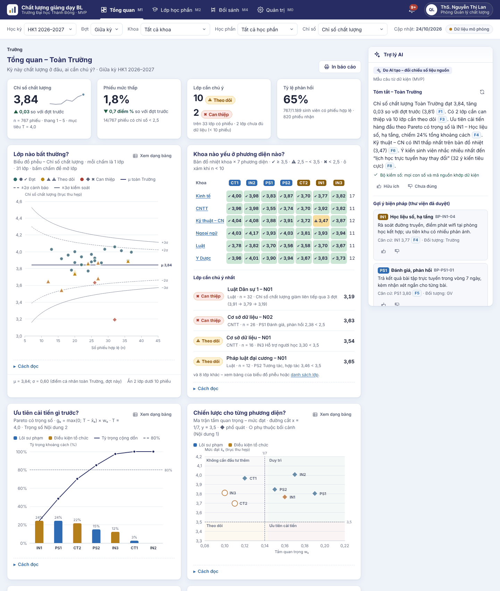
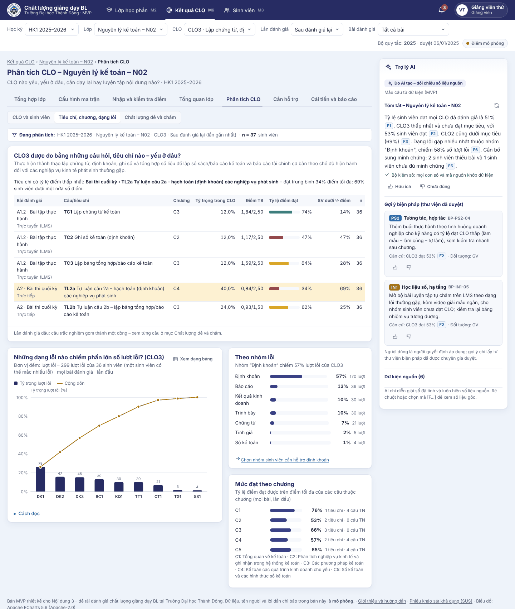
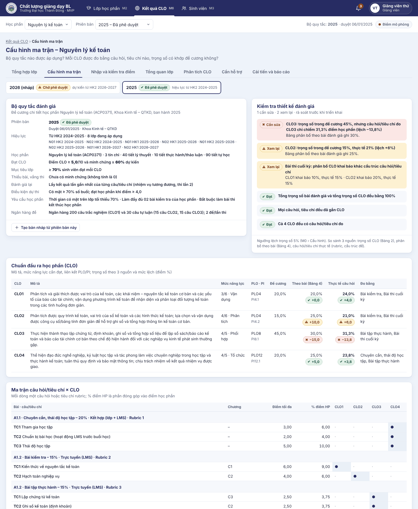

# Dashboard chất lượng giảng dạy BL – bản MVP

Bản MVP chạy được của **Nội dung 3** đề tài *“Đánh giá chất lượng giảng dạy trong môi trường học tập kết hợp (Blended Learning) tại Trường Đại học Thành Đông”*, xây dựng theo tài liệu **Dashboard chất lượng giảng dạy BL – Ý tưởng và kiến trúc v1.0 (28/10/2026)**.

Mục đích của bản này là phục vụ **công việc 3.1 – thiết kế**: phỏng vấn 6 – 8 người dùng, chốt yêu cầu, thử bộ tính toán trên dữ liệu đối sánh, và tổ chức thử nghiệm khả dụng (TC3) trước khi xây dựng bản chính thức trên máy chủ của Trường.

> **Toàn bộ số liệu, tên người và lời dẫn chỉ báo trong bản này là MÔ PHỎNG.** Bộ dữ liệu được sinh có hạt giống cố định, có sẵn “kịch bản” để trình diễn (lớp theo dõi, lớp can thiệp, vấn đề chung của một khoa, lớp dưới 10 phiếu). Dữ liệu thật được nhập qua M0 › Nhập dữ liệu theo mẫu Phụ lục A.



## Có gì trong bản MVP

| Màn hình | Câu hỏi | Nội dung chính |
|---|---|---|
| **M1** Tổng quan Trường, khoa | Kỳ này chất lượng ở đâu, ai cần chú ý? | 4 thẻ KPI có so sánh đợt trước · biểu đồ phễu (bấm chấm mở lớp) · bản đồ nhiệt khoa × 7 phương diện · Pareto có trọng số · ma trận tầm quan trọng – mức đạt (◆/○) · histogram tô 3 mức · xu hướng và biểu đồ kiểm soát XmR (từ 6 đợt) · chủ đề ý kiến kèm câu trích ẩn danh |
| **M2** Lớp học phần | Lớp này yếu ở đâu, làm gì? | Trạng thái và lý do cảnh báo · diễn biến qua các đợt · hồ sơ 7 phương diện dạng bullet chart (ngưỡng 3,5, TB Trường, so với đợt trước) · 5 chỉ báo thấp nhất · ý kiến sinh viên · **kế hoạch cải tiến PDCA** tự so sánh trước – sau |
| **M3** Sinh viên (chế độ mô phỏng) | Ai cần hỗ trợ ngay? | Dải “Mô phỏng – không dùng để xếp loại hay xử lý học vụ” · gắn kết × điểm quá trình · danh sách nguy cơ có xác suất logistic · ô “đã liên hệ” · mọi lượt xem đều ghi nhật ký |
| **M4** Đối sánh liên trường | So với trường đối sánh ra sao? | Forest plot chênh lệch trung bình tiềm ẩn (KTC 95%), chỉ trên nhân tố đạt bất biến; nhân tố không đạt tô xám kèm lý do |
| **M5** Trợ lý AI (khung phải M1 – M3) | — | Tóm tắt 3 – 5 câu có mã nguồn [F1]…, rê chuột xem số liệu gốc · bộ kiểm số · gợi ý biện pháp chỉ từ thư viện đã duyệt (“Áp dụng vào kế hoạch”) · 👍/👎 |
| **M0** Quản trị và kiểm chứng | Dữ liệu đúng chưa? Đạt TC1 – TC4 chưa? | Dữ liệu và công bố đợt · nhập tệp 5 bước (báo lỗi theo dòng) · cấu hình có lịch sử và “xem trước tác động” · danh mục · người dùng, nhật ký truy cập · thư viện biện pháp (duyệt) · **kiểm chứng TC1 – TC4** · mô-đun AI, thử bộ kiểm số |
| **M6** Kết quả học tập theo CLO | Lớp đạt chuẩn đầu ra đến đâu, yếu ở đâu, ai cần hỗ trợ? | Cấu hình ma trận (CLO, PLO/PI, phê duyệt, kiểm tra câu hỏi × CLO) · nhập và kiểm tra điểm Excel/LMS · tổng quan lớp (phễu minh chứng, histogram, box plot, quá trình × thi) · phân tích CLO (cột + radar, sinh viên × CLO, tiêu chí, chương, Pareto dạng lỗi, chất lượng đề, hai cán bộ chấm) · cần hỗ trợ · cải tiến và báo cáo học phần – xem [mục riêng](#kết-quả-học-tập-theo-clo-m6) |

Ngoài ra: **đăng nhập** (quản trị cấp tài khoản, khách chỉ xem), phân quyền theo vai trò và phạm vi (lọc ở tầng truy vấn), thông báo trong ứng dụng khi công bố đợt, phiếu SUS tích hợp (TC3), giao diện chấm AI cho 2 chuyên gia (TC4), xuất minh chứng PDCA (CSV), giao diện điện thoại, đạt kiểm tra tự động WCAG 2.1 AA (axe-core) trên mọi màn hình.

## Chạy thử trên máy

Cần Node.js ≥ 20 (không cần cài thêm gói nào).

```bash
npm start
```

Mở <http://localhost:8080> rồi đăng nhập (xem [Đăng nhập và tài khoản](#đăng-nhập-và-tài-khoản)). Có thể dùng bất kỳ máy chủ tĩnh nào trỏ vào thư mục `web/` (ví dụ `python3 -m http.server -d web 8080`). Mở trực tiếp tệp `index.html` bằng `file://` sẽ không chạy vì trình duyệt chặn mô-đun JavaScript.

```bash
npm test
```

Chạy 57 kiểm thử đơn vị: bộ tính toán (đáp số tính tay ở mục 4), nhập tệp, bộ kiểm số, xóa thông tin nhận diện, “kịch bản” của dữ liệu mô phỏng, phần đăng nhập (băm mật khẩu đối chiếu `node:crypto`, quy tắc tài khoản, gộp 3 chiều khi đăng lên GitHub, vai trò khách), và mô-đun CLO (điểm CLO, độ bao phủ minh chứng, kiểm tra ma trận, độ khó – độ phân biệt, hai cán bộ chấm, Pareto, tệp điểm Excel/LMS, kịch bản mô phỏng).

## Đưa lên GitHub Pages

Vào **Settings › Pages › Build and deployment**, chọn một trong hai cách (làm một lần):

| Source | Chọn thêm | Ai đăng trang |
|---|---|---|
| **Deploy from a branch** | Branch: nhánh mặc định (hiện là `claude/busy-euler-bp30mo`), thư mục **/ (root)** › Save | GitHub tự đăng lại sau mỗi lần push |
| **GitHub Actions** | Tab **Actions › Triển khai GitHub Pages › Run workflow** | Quy trình `.github/workflows/pages.yml` chạy kiểm thử xong mới đăng |

Sau 1 – 2 phút (theo dõi ở tab **Actions**), mở **<https://mrtmrtus.github.io/Dashboard-blended/>**: trang gốc tự chuyển vào dashboard ở `…/Dashboard-blended/web/`. Hai cách cho cùng đường dẫn. Tệp `.nojekyll` ở gốc repo giữ GitHub không dựng lại repo bằng Jekyll – thiếu nó, trang gốc chỉ hiện nội dung README.

Nếu sau này đổi nhánh mặc định sang `main`: cách “Deploy from a branch” cần chọn lại nhánh trong Settings › Pages; cách “GitHub Actions” tự theo nhánh mặc định. Khi Pages chưa bật hoặc đang chọn “Deploy from a branch”, quy trình `pages.yml` chỉ chạy kiểm thử, không báo lỗi.

Gặp **404**: đợi lượt triển khai trong tab Actions chạy xong rồi tải lại trang (Ctrl + F5), và gõ đúng chữ hoa – thường `Dashboard-blended`.

Mọi đường dẫn đều tương đối và định tuyến bằng `#/…`, nên trang cũng chạy được trên máy chủ tĩnh của Trường mà không cần cấu hình thêm.

## Logo Trường

Logo chính thức của Trường Đại học Thành Đông nằm ở `web/assets/logo-tdu.png` (256 × 256 px, ngoài vòng tròn trong suốt), hiện ở thanh trên cùng, màn hình đăng nhập và biểu tượng trên thẻ trình duyệt. Muốn thay logo chỉ cần ghi đè tệp này (PNG vuông, nền trong suốt), không cần sửa mã; thiếu tệp thì trang tạm dùng biểu trưng của ứng dụng (khối cột).

## Đăng nhập và tài khoản

Mở trang là gặp màn hình đăng nhập. Gửi đường dẫn <https://mrtmrtus.github.io/Dashboard-blended/> cho ai thì người đó đăng nhập được **trên máy của họ** bằng mọi tài khoản có trong tệp [`web/data/accounts.json`](web/data/accounts.json) đã đăng. Có sẵn 2 tài khoản (mật khẩu do nhóm nghiên cứu giữ, không ghi ở đây):

| Tên đăng nhập | Vai trò | Được làm gì |
|---|---|---|
| `admin` | Quản trị hệ thống | Cấp tài khoản (M0 › Tài khoản, nhật ký), quản trị dữ liệu, cấu hình, kiểm chứng; xem thử dưới vai trò khác để trình diễn phân quyền |
| `guess` | Khách (chỉ xem) | Xem chỉ số ở M1 Tổng quan, M2 Lớp học phần, M4 Đối sánh; không chỉnh sửa, không xem dữ liệu sinh viên, không vào M0 |

- **Cấp tài khoản:** admin vào M0 › Tài khoản, nhật ký › *Tạo tài khoản* (chọn vai trò và phạm vi: khoa, giảng viên, cố vấn học tập…), đặt lại mật khẩu, khóa hoặc xóa. Thay đổi có hiệu lực ngay trên máy của admin, và **áp dụng cho mọi máy** theo một trong hai cách ở thẻ *Đăng nhập trên mọi máy*:
  1. **Tự đăng lên GitHub (khuyên dùng):** kết nối một lần bằng token GitHub *fine-grained* chỉ có quyền *Contents: Read and write* trên repo này (thẻ có hướng dẫn tạo token từng bước). Từ đó mỗi thay đổi tài khoản được trang tự ghi vào `web/data/accounts.json`; GitHub Pages đăng lại trang và khoảng 1 – 2 phút sau mọi máy đăng nhập được. Nếu hai quản trị cùng sửa, danh sách được gộp theo từng tài khoản, không ai ghi đè mất tài khoản của người kia. Token chỉ lưu trong trình duyệt của máy admin – chỉ kết nối trên máy riêng.
  2. **Thủ công:** bấm *Tải tệp accounts.json* rồi tải tệp lên GitHub, ghi đè `web/data/accounts.json`.
- Mỗi lần đăng là một commit vào nhánh mặc định (tên tài khoản GitHub của admin), nên người sửa mã nguồn nhớ `git pull` trước khi push.
- Mật khẩu chỉ lưu dạng băm PBKDF2-SHA256 có muối. Nhập sai 5 lần thì tạm khóa 30 giây. Phiên đăng nhập kết thúc khi đóng thẻ (tối đa 12 giờ), hoặc sau 7 ngày nếu chọn “Ghi nhớ đăng nhập”; đặt lại mật khẩu, khóa hay xóa tài khoản làm phiên cũ hết hiệu lực. Đăng nhập, đăng xuất, thay đổi tài khoản đều được ghi nhật ký.
- **Quên mật khẩu admin:** chạy `npm run account -- set-password admin` (nhập mật khẩu mới), rồi commit và push tệp `web/data/accounts.json`.
- **Giới hạn:** đây là trang tĩnh nên bước đăng nhập kiểm tra ngay trên trình duyệt – đủ để phân quyền khi thử nghiệm, nhưng người rành kỹ thuật vẫn đọc được mã nguồn và các tệp công khai. Không đưa dữ liệu thật lên GitHub Pages; bản chính thức đặt đăng nhập trên máy chủ của Trường (Django, LDAP/OIDC).

## Thử nhanh theo vai trò

Đăng nhập `admin`, bấm vào tên ở góc phải trên › **Xem thử dưới vai trò** để thấy màn hình và dữ liệu đúng phạm vi của từng vai trò (nhật ký vẫn ghi theo tài khoản admin):

| Vai trò | Thử gì |
|---|---|
| Phòng QLCL | M1 → bấm chấm đỏ “Cơ sở dữ liệu – N02” trên biểu đồ phễu → đọc lý do (PS1 < 2,5) → M0 › Kiểm chứng |
| Lãnh đạo Khoa Kỹ thuật – CN | Bộ lọc khoa bị khóa; bản đồ nhiệt cho thấy IN1 (học liệu số, hạ tầng) yếu chung cả khoa |
| Giảng viên ThS. Hoàng Hữu Bình | Lớp “Marketing căn bản – N03”: 🟡 THEO DÕI (IN1 < 3,5) → bấm “Áp dụng vào kế hoạch” từ gợi ý của trợ lý AI |
| Cố vấn học tập | M3: sinh viên mình phụ trách, đánh dấu “đã liên hệ” |
| Nhóm nghiên cứu, quản trị | M0 › Nhập dữ liệu › “Thử tệp mẫu có lỗi” · Kiểm chứng TC2 › “So sánh các mức giảm tối thiểu” |
| Ban Giám hiệu | Chỉ xem M1 – tổng hợp toàn Trường; M6 ở mức tổng hợp lớp |
| Giảng viên Nguyên lý kế toán (`gv:GV04`) | M6 › chọn HK1 2025–2026, lớp N02 › Phân tích CLO › “Tiêu chí, chương, dạng lỗi”: CLO3 thấp, yếu ở câu 2a (định khoản), nhóm lỗi định khoản > ½ lượt lỗi → Cần hỗ trợ → Cải tiến và báo cáo |
| Lãnh đạo Khoa Kinh tế (`khoa:KT`) | M6 › Cấu hình ma trận › bản nháp 2026: sửa ô ma trận, “Xem trước tác động”, “Phê duyệt” |

Thao tác (kế hoạch cải tiến, đã liên hệ, cấu hình, phiếu SUS, chấm AI, nhật ký) được lưu trong trình duyệt đang dùng. Muốn bắt đầu lại: xóa dữ liệu trang web của trình duyệt.

## Dữ liệu và tệp mẫu (Phụ lục A)

Thư mục [`web/templates/`](web/templates) có tệp mẫu sinh từ dữ liệu mô phỏng (học kỳ HK1 2026–2027), mẫu trống chỉ có dòng tiêu đề, và `phieu_khao_sat_loi_mau.csv` cố ý có lỗi để thử báo lỗi theo dòng.

| Tệp | Cột bắt buộc |
|---|---|
| `danh_muc_lop.csv` | ma_lop_hp, ten_hoc_phan, ma_khoa, ma_giang_vien, hoc_ky, si_so (tùy chọn: ma_hoc_phan, nhom, ten_khoa, ten_giang_vien) |
| `sinh_vien.csv` *(bổ sung đề xuất)* | ma_nghien_cuu, lop_sinh_hoat, ma_co_van (tùy chọn: ten_co_van, ma_khoa) |
| `phieu_khao_sat.csv` | ma_phieu, ma_nghien_cuu, ma_lop_hp, dot (GK/CK), thoi_gian_tra_loi, Q_C1_1 … Q_Pt2_5 (62 cột), EB1 … EC4 (12 cột), kiem_tra_chu_y_1, kiem_tra_chu_y_2, y_kien, dong_y_lien_ket |
| `diem_hoc_vu.csv` | ma_nghien_cuu, ma_lop_hp, diem_qua_trinh, diem_hoc_phan, gpa0 |
| `tham_so_nghien_cuu.csv` | loai (trong_so / bat_bien / chenh_lech_tiem_an), ma, gia_tri, can_duoi, can_tren, ghi_chu |
| `thu_vien_bien_phap.csv` | ma_bien_phap, ma_phuong_dien, ma_chi_bao, noi_dung, doi_tuong (GV/khoa/Trường), nguon, trang_thai_duyet |

Tệp của mô-đun CLO (M6 › Nhập và kiểm tra điểm, dấu chấm phẩy, số kiểu `7,5`):

| Tệp | Cột bắt buộc |
|---|---|
| `clo_hoc_phan.csv` | ma_hoc_phan, phien_ban, ma_clo, mo_ta, linh_vuc (kien_thuc/ky_nang/tu_chu), muc_nang_luc (3/6, 4/5…), trong_so (%) – tùy chọn: ma_plo, ma_pi, chuong, nguong_dat |
| `ma_tran_danh_gia.csv` | ma_hoc_phan, phien_ban, ma_bai_danh_gia, ten_bai, nhom (A1/A2), trong_so_bai, ma_cau, noi_dung, diem_toi_da, ma_clo (`CLO3` hoặc `CLO3:0,5\|CLO4:0,5`) – tùy chọn: hinh_thuc, ma_de, ma_de_lan_2, so_lan_toi_da, chuong, phan_bo_clo, ma_loi |
| `danh_sach_lop.csv` | ma_lop_hp, ma_nghien_cuu – tùy chọn: trang_thai, ty_le_chuyen_can |
| `diem_chi_tiet.csv` (dạng dài, từ LMS) | ma_nghien_cuu, ma_lop_hp, ma_bai_danh_gia, lan_thi, ma_de, ma_cau, diem – tùy chọn: trang_thai, ngay, nguoi_cham_1/2, diem_cham_1/2, ma_loi, phuong_an |
| `diem_theo_bai.csv` (bảng Excel) | ma_nghien_cuu, ma_lop_hp, ma_bai_danh_gia, lan_thi, ma_de + một cột cho mỗi mã câu/tiêu chí |

`diem_chi_tiet_loi_mau.csv` cố ý có lỗi (trùng dòng, vượt điểm tối đa, sai mã đề, sai lần thi, sinh viên ngoài lớp, thiếu điểm…) để thử nút “Thử tệp mẫu có lỗi”. CLO và ma trận nhập vào thành **bản nháp**, chỉ dùng tính kết quả sau khi được phê duyệt.

Bộ kiểm tra nhận CSV dấu phẩy hoặc chấm phẩy (Excel tiếng Việt), số kiểu `3,5` hoặc `3.5`, ngày `dd/mm/yyyy hh:mm`; báo lỗi theo dòng (thiếu cột, ô trống, giá trị ngoài phạm vi, trùng mã phiếu, trùng phiếu cùng sinh viên – lớp – đợt, lớp không có trong danh mục) và **từ chối mã giống mã sinh viên thật**. Tệp được đọc ngay trong trình duyệt, không gửi đi đâu. Sau khi sửa bộ sinh dữ liệu, chạy `npm run samples` để cập nhật tệp mẫu.

Mã chỉ báo của MVP: CT1→`Q_C1_*`, CT2→`Q_C2_*`, IN1→`Q_I1_*`, IN2→`Q_I2_*`, IN3→`Q_I3_*`, PS1→`Q_P1_*`, PS2→`Q_P2_*`, PT1→`Q_Pt1_*`, PT2→`Q_Pt2_*` – cần đối chiếu với mã gốc của bộ tiêu chí (xem [docs/thiet-ke-mvp.md](docs/thiet-ke-mvp.md)).

## Bộ tính toán (mục 4)

Toàn bộ nằm trong [`web/js/core/`](web/js/core) – mô-đun JavaScript thuần, không phụ thuộc giao diện, kiểm thử được bằng Node:

| Tệp | Nội dung |
|---|---|
| `scoring.js` | Phiếu hợp lệ (câu chú ý, SD = 0, ≥ 80% chỉ báo), điểm nhân tố (≥ 2/3 chỉ báo), chỉ số chất lượng, điểm nhóm, điểm gắn kết, 3 mức |
| `engine.js` | Tính theo lô: tổng hợp lớp, khoa, Trường (mean, sd, n), μ/σ phễu theo từng chỉ số và đợt, z, cảnh báo lớp và sinh viên, ý kiến, mô hình nguy cơ |
| `funnel.js`, `priority.js` | μ ± z·σ/√n · gₖ = max(0, T − x̄ₖ) × wₖ · 4 vùng của ma trận ưu tiên |
| `alerts.js` | Quy tắc 🟡/🔴 cấp lớp (7 phương diện) và cấp sinh viên |
| `logistic.js` | Hồi quy logistic (IRLS), kiểm định chéo 10 lần phân tầng, ROC, AUC, ngưỡng Youden |
| `montecarlo.js` | TC2: mô phỏng lớp “không khác biệt” bằng lấy mẫu lại phiếu thật, theo phân bố sĩ số thực |
| `factcheck.js`, `redact.js` | Bộ kiểm số cho văn bản AI; xóa tên, số điện thoại, mã số, email trong ý kiến |
| `importer.js`, `csv.js` | Đọc CSV, kiểm tra 6 loại tệp, báo lỗi theo dòng |

## Kết quả học tập theo CLO (M6)



Mô-đun phân tích kết quả người học theo học phần, đánh giá theo chuẩn đầu ra học phần (CLO). Học phần thí điểm là **Nguyên lý kế toán (ACP0371)**: 4 CLO, PLO/PI, mức năng lực, trọng số (Bảng 2), bài đánh giá A1.1 – A1.2 – A2 và phân bổ CLO (Bảng 4 – 5), rubric 1 – 4 và cấu trúc đề thi (12 câu trắc nghiệm + 2 câu tự luận, 2 đề/lần thi) lấy từ **đề cương chi tiết học phần**. **Điểm của sinh viên là mô phỏng** (`web/js/data/clo-synthetic.js`); điểm tối đa của từng tiêu chí rubric 1 – 3, danh mục dạng lỗi và bản nháp 2026 là phần MVP đề xuất.

| Màn hình (`#/clo/…`) | Nghiệp vụ | Nội dung |
|---|---|---|
| Tổng hợp lớp | 4 | Tỷ lệ đạt từng CLO của các lớp, số sinh viên cần hỗ trợ, bộ quy tắc chờ phê duyệt |
| Cấu hình ma trận | 1, 2 | Phiên bản đề cương (đã phê duyệt / chờ phê duyệt / bản nháp), CLO – PI – PLO, mức năng lực, ngưỡng đạt; ma trận câu hỏi/tiêu chí × CLO sửa được ở bản nháp; kiểm tra thiết kế (CLO chưa đo, phần điểm chưa gắn CLO, trọng số lệch giữa Bảng 2 – Bảng 4 – câu hỏi thực tế, phân bổ CLO của bài khác cấu trúc đề); xem trước tác động; phê duyệt có lịch sử |
| Nhập và kiểm tra điểm | 3 | 5 loại tệp, báo lỗi theo dòng: trùng sinh viên, thiếu điểm, vượt điểm tối đa, sai mã đề, sai lần thi, ngoài danh sách lớp, mã sinh viên thật; tình trạng thu thập minh chứng của lớp; kiểm tra lại dữ liệu đã lưu |
| Tổng quan lớp | 4, 8 | Phễu minh chứng (thuộc diện → đã nộp → đã chấm → đủ minh chứng → đạt), histogram có ngưỡng và vùng sát ngưỡng, box plot so sánh lớp/học kỳ cùng bộ quy tắc, điểm quá trình × điểm thi, đối chiếu khảo sát BL của cùng lớp, trợ lý AI |
| Phân tích CLO | 4, 5, 7 | Cột + radar cùng chỉ số; ma trận sinh viên × CLO (bấm ô xem điểm nguồn); câu hỏi/tiêu chí, chương, Pareto dạng lỗi (đơn vị lượt lỗi, kèm số sinh viên); độ khó – độ phân biệt, phương án sai thường gặp, so sánh mã đề, đối chiếu hai cán bộ chấm |
| Cần hỗ trợ | 6 | Thiếu bài, chưa đủ minh chứng, chưa đạt, sát ngưỡng; giao nhiệm vụ (nội dung, người phụ trách, hạn), đánh giá lại bằng nhiệm vụ tương đương, kết quả trước – sau tự cập nhật |
| Cải tiến và báo cáo | 8, 9, 10 | Run chart có mốc cải tiến, biểu đồ kiểm soát để giai đoạn sau (chỉ bật khi đủ chuỗi đợt tương đương), so sánh lớp/học kỳ, theo dõi cải tiến (vấn đề – minh chứng – biện pháp – phụ trách – hạn – kết quả đánh giá lại), báo cáo học phần in được, CSV truy lại điểm nguồn |

**Cách tính (đề xuất, chốt ở công việc 3.1):** mỗi câu/tiêu chí đóng góp vào điểm học phần theo trọng số bài × điểm tối đa câu; điểm CLO (thang 10) là trung bình có trọng số các câu gắn CLO đã có điểm; *đạt* khi điểm CLO ≥ 5,0 và có ≥ 60% minh chứng dự kiến; vắng thi, không nộp bài là *chưa có minh chứng* (không tính là 0); đánh giá lại lấy kết quả lần gần nhất của từng câu; mục tiêu lớp ≥ 70% sinh viên đạt mỗi CLO (mục tiêu, không phải giới hạn kiểm soát).



**Khi nạp đề cương, bộ kiểm tra ma trận phát hiện:** trọng số CLO3 ở Bảng 2 là 45% nhưng các câu hỏi/tiêu chí đo CLO3 chỉ chiếm 31,25% điểm học phần (Bảng 4 ghi 30%); CLO2 15% so với 21% thực tế (Bảng 4 ghi 25%); bài thi cuối kỳ ở Bảng 4 ghi CLO1 10% – CLO2 20%, còn cấu trúc đề ở mục 10 cho CLO1 15% – CLO2 15%. Bản nháp 2026 trong MVP là ví dụ chỉnh ma trận (giữ nguyên trọng số CLO) để trình diễn quy trình phê duyệt – quyết định thuộc bộ môn, khoa.

**Kịch bản mô phỏng:** HK1 2025–2026 CLO3 dưới mục tiêu (≈ 50%), câu 2a định khoản yếu nhất, nhóm lỗi định khoản > ½ lượt lỗi, hai cán bộ chấm lệch nhiều ở câu 2a lớp N02 → kế hoạch KH-0003, KH-0004 → HK2 2025–2026 CLO3 ≈ 77%, độ lệch chấm ≈ 0. HK1 2026–2027 (đang học, mới có bài kiểm tra): lớp N02 yếu tiêu chí “Hạch toán nghiệp vụ” → nhóm phụ đạo → kiểm tra lại bằng đề tương đương ngày 13/11 (CLO2 46% → 85%). Ngân hàng trắc nghiệm có câu ghi nhầm đáp án (TN087), câu quá dễ, phương án nhiễu mạnh để thử rà soát đề.

**Gắn với dashboard BL (một nền tảng):** cùng danh mục lớp, giảng viên, sinh viên (mã nghiên cứu) và phân quyền theo vai trò – phạm vi; điểm học vụ ở M3 của các lớp có dữ liệu CLO được tính từ điểm chi tiết (một nguồn số liệu); trang lớp ở M2 có thẻ “Kết quả học tập theo CLO”, M3 có cột kết quả CLO; kế hoạch cải tiến CLO lưu chung kho PDCA (hiện ở M2 và M0 › Xuất minh chứng PDCA), mỗi biện pháp gắn một phương diện giảng dạy BL và lấy từ cùng thư viện biện pháp đã duyệt; M6 đối chiếu chỉ báo khảo sát “Tôi đạt được chuẩn đầu ra của học phần”, PS1 “Đánh giá, phản hồi”, điểm gắn kết với kết quả CLO đo được; thông báo, trợ lý AI (dữ kiện có mã, bộ kiểm số), nhật ký xem dữ liệu sinh viên và tham số ở M0 › Cấu hình dùng chung.

## Mô-đun AI

- Mặc định (chạy được cả trên GitHub Pages): văn bản sinh **bằng mẫu câu từ chính các dữ kiện F1, F2…**, phân loại ý kiến bằng bộ quy tắc từ khóa. Giao diện ghi rõ bộ máy đang dùng.
- Tùy chọn **Ollama nội bộ** (M0 › Mô-đun AI): gửi dữ kiện có mã và lời nhắc hệ thống ở Phụ lục B tới `/api/chat`, nhận JSON `{"tom_tat", "goi_y"}`, chạy bộ kiểm số; có số lạ thì sinh lại tối đa 2 lần rồi gắn cờ “cần xem lại”; gợi ý chỉ giữ mã biện pháp có trong thư viện đã duyệt. Khi chạy trên máy chủ nội bộ, đặt `OLLAMA_ORIGINS` cho phép địa chỉ của dashboard.
- Chế độ “chuyên gia duyệt trước khi hiển thị” cho học kỳ thí điểm.

## Cấu trúc mã nguồn

```text
web/                     # toàn bộ trang tĩnh – thư mục được triển khai
├─ index.html
├─ assets/               # css/ (tokens.css màu TDU mục 9, app.css) · logo-tdu.png (logo Trường, cũng là biểu tượng thẻ)
├─ data/accounts.json    # tài khoản đăng nhập (mật khẩu đã băm)
├─ js/core/              # bộ tính toán thuần (mục 4), băm mật khẩu, quy tắc tài khoản
├─ js/data/              # danh mục, dữ liệu mô phỏng, thư viện biện pháp, tham số nghiên cứu, xuất/nhập CSV; clo-catalog.js (đề cương ACP0371), clo-synthetic.js
├─ js/ai/                # dữ kiện có mã, sinh văn bản, phân loại ý kiến, gọi Ollama
├─ js/ui/                # thành phần giao diện, biểu đồ ECharts, biểu tượng
├─ js/views/             # M0 – M6 (clo-*.js: 6 màn hình kết quả CLO + báo cáo), đăng nhập, phiếu SUS, giới thiệu
├─ js/api-clo.js         # tầng truy vấn M6 theo vai trò; core/clo.js, core/clo-import.js: bộ tính toán, kiểm tra tệp CLO
├─ js/api.js             # tầng truy vấn theo vai trò (tương ứng đường dẫn mục 5.8)
├─ js/auth.js            # đăng nhập, phiên, cấp tài khoản
├─ js/github.js          # quản trị đăng accounts.json lên repo qua GitHub API (token fine-grained)
├─ js/access.js          # vai trò, phạm vi, người dùng mô phỏng để “xem thử”
├─ js/store.js           # lưu trữ cục bộ (localStorage, IndexedDB)
├─ templates/            # tệp CSV mẫu (Phụ lục A)
└─ vendor/echarts/       # Apache ECharts 5.6.0 đóng gói kèm (không tải từ mạng)
tests/                   # kiểm thử đơn vị (node --test), dữ liệu mẫu có đáp số tính tay
scripts/                 # máy chủ chạy thử, sinh tệp mẫu, quản lý tài khoản (npm run account)
docs/                    # ghi chú thiết kế, ảnh chụp màn hình
```

## Giới hạn của bản MVP

- **Không thay được bảo mật phía máy chủ.** Ứng dụng tĩnh chạy hoàn toàn trên trình duyệt – kể cả bước đăng nhập – nên phân quyền ở `api.js` chỉ mô phỏng logic “lọc ở tầng truy vấn”; dữ liệu thật phải đặt sau máy chủ có đăng nhập (bản Django), không công khai trên GitHub Pages.
- Dữ liệu nhập và thao tác lưu trong trình duyệt của từng người (localStorage, IndexedDB), không đồng bộ giữa các máy; riêng danh sách tài khoản áp dụng cho mọi máy qua tệp `web/data/accounts.json`.
- Bộ tính toán chạy trên trình duyệt khi mở trang (~0,9 giây trên máy tính thông thường; chậm hơn trên máy yếu). Bản chính thức tính sẵn theo lô trên máy chủ và giao diện chỉ đọc bảng tổng hợp.
- Lời dẫn chỉ báo, tên khoa, học phần, giảng viên, tham số Nội dung 1, 2 đều là minh họa.

Các quyết định cần chốt ở công việc 3.1 và lộ trình chuyển sang kiến trúc chính thức (Django + PostgreSQL + HTMX + ECharts + Ollama, Docker Compose) được ghi trong [docs/thiet-ke-mvp.md](docs/thiet-ke-mvp.md).

## Giấy phép thành phần

Apache ECharts 5.6.0 – Apache License 2.0 (xem `web/vendor/echarts/LICENSE`, `NOTICE`). Mã nguồn của dashboard thuộc đề tài; chưa gắn giấy phép mở.
