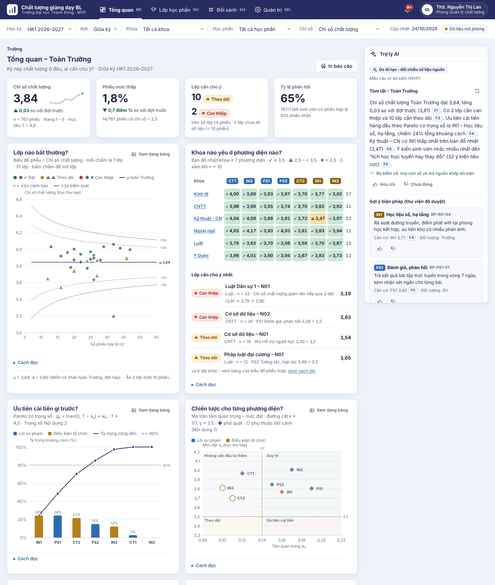

# Dashboard chất lượng giảng dạy BL – bản MVP

Bản MVP chạy được của **Nội dung 3** đề tài *“Đánh giá chất lượng giảng dạy trong môi trường học tập kết hợp (Blended Learning) tại Trường Đại học Thành Đông”*, xây dựng theo tài liệu **Dashboard chất lượng giảng dạy BL – Ý tưởng và kiến trúc v1.0 (28/10/2026)**.

Mục đích của bản này là phục vụ **công việc 3.1 – thiết kế**: phỏng vấn 6 – 8 người dùng, chốt yêu cầu, thử bộ tính toán trên dữ liệu đối sánh, và tổ chức thử nghiệm khả dụng (TC3) trước khi xây dựng bản chính thức trên máy chủ của Trường.

> **Toàn bộ số liệu, tên người và lời dẫn chỉ báo trong bản này là MÔ PHỎNG.** Bộ dữ liệu được sinh có hạt giống cố định, có sẵn “kịch bản” để trình diễn (lớp theo dõi, lớp can thiệp, vấn đề chung của một khoa, lớp dưới 10 phiếu). Dữ liệu thật được nhập qua M0 › Nhập dữ liệu theo mẫu Phụ lục A.



## Có gì trong bản MVP

| Màn hình | Câu hỏi | Nội dung chính |
|---|---|---|
| **M1** Tổng quan Trường, khoa | Kỳ này chất lượng ở đâu, ai cần chú ý? | 4 thẻ KPI có so sánh đợt trước · biểu đồ phễu (bấm chấm mở lớp) · bản đồ nhiệt khoa × 7 phương diện · Pareto có trọng số · ma trận tầm quan trọng – mức đạt (◆/○) · histogram tô 3 mức · xu hướng và biểu đồ kiểm soát XmR (từ 6 đợt) · chủ đề ý kiến kèm câu trích ẩn danh |
| **M2** Lớp học phần | Lớp này yếu ở đâu, làm gì? | Trạng thái và lý do cảnh báo · diễn biến qua các đợt · hồ sơ 7 phương diện dạng bullet chart (ngưỡng 3,5, TB Trường, so với đợt trước) · 5 chỉ báo thấp nhất · ý kiến sinh viên · **kế hoạch cải tiến PDCA** tự so sánh trước – sau |
| **M3** Sinh viên (chế độ mô phỏng) | Ai cần hỗ trợ ngay? | Dải “Mô phỏng – không dùng để xếp loại hay xử lý học vụ” · gắn kết × điểm quá trình · danh sách nguy cơ có xác suất logistic · ô “đã liên hệ” · mọi lượt xem đều ghi nhật ký |
| **M4** Đối sánh liên trường | So với trường đối sánh ra sao? | Forest plot chênh lệch trung bình tiềm ẩn (KTC 95%), chỉ trên nhân tố đạt bất biến; nhân tố không đạt tô xám kèm lý do |
| **M5** Trợ lý AI (khung phải M1 – M3) | — | Tóm tắt 3 – 5 câu có mã nguồn [F1]…, rê chuột xem số liệu gốc · bộ kiểm số · gợi ý biện pháp chỉ từ thư viện đã duyệt (“Áp dụng vào kế hoạch”) · 👍/👎 |
| **M0** Quản trị và kiểm chứng | Dữ liệu đúng chưa? Đạt TC1 – TC4 chưa? | Dữ liệu và công bố đợt · nhập tệp 5 bước (báo lỗi theo dòng) · cấu hình có lịch sử và “xem trước tác động” · danh mục · người dùng, nhật ký truy cập · thư viện biện pháp (duyệt) · **kiểm chứng TC1 – TC4** · mô-đun AI, thử bộ kiểm số |

Ngoài ra: phân quyền theo vai trò và phạm vi (lọc ở tầng truy vấn), thông báo trong ứng dụng khi công bố đợt, phiếu SUS tích hợp (TC3), giao diện chấm AI cho 2 chuyên gia (TC4), xuất minh chứng PDCA (CSV), giao diện điện thoại, đạt kiểm tra tự động WCAG 2.1 AA (axe-core) trên mọi màn hình.

## Chạy thử trên máy

Cần Node.js ≥ 20 (không cần cài thêm gói nào).

```bash
npm start
```

Mở <http://localhost:8080>. Có thể dùng bất kỳ máy chủ tĩnh nào trỏ vào thư mục `web/` (ví dụ `python3 -m http.server -d web 8080`). Mở trực tiếp tệp `index.html` bằng `file://` sẽ không chạy vì trình duyệt chặn mô-đun JavaScript.

```bash
npm test
```

Chạy 30 kiểm thử đơn vị của bộ tính toán (đáp số tính tay ở mục 4), nhập tệp, bộ kiểm số, xóa thông tin nhận diện và “kịch bản” của dữ liệu mô phỏng.

## Đưa lên GitHub Pages

1. Vào **Settings › Pages › Build and deployment**, chọn **Source: GitHub Actions** (làm một lần).
2. Vào tab **Actions › Triển khai GitHub Pages › Run workflow** (hoặc push một commit lên nhánh mặc định).
3. Quy trình `.github/workflows/pages.yml` chạy kiểm thử rồi triển khai thư mục `web/`. Trang có dạng `https://<tài-khoản>.github.io/Dashboard-blended/`.

Quy trình luôn triển khai từ **nhánh mặc định** của repo, nên vẫn đúng nếu sau này đổi nhánh mặc định sang `main`. Khi Pages chưa bật, quy trình chỉ chạy kiểm thử và ghi chú nhắc bật Pages, không báo lỗi.

Mọi đường dẫn đều tương đối và định tuyến bằng `#/…`, nên trang cũng chạy được trên máy chủ tĩnh của Trường mà không cần cấu hình thêm.

## Thử nhanh theo vai trò

Bản MVP không có đăng nhập. Bấm vào tên người dùng ở góc phải trên để chọn tài khoản mô phỏng:

| Vai trò | Thử gì |
|---|---|
| Phòng QLCL (mặc định) | M1 → bấm chấm đỏ “Cơ sở dữ liệu – N02” trên biểu đồ phễu → đọc lý do (PS1 < 2,5) → M0 › Kiểm chứng |
| Lãnh đạo Khoa Kỹ thuật – CN | Bộ lọc khoa bị khóa; bản đồ nhiệt cho thấy IN1 (học liệu số, hạ tầng) yếu chung cả khoa |
| Giảng viên ThS. Hoàng Hữu Bình | Lớp “Marketing căn bản – N03”: 🟡 THEO DÕI (IN1 < 3,5) → bấm “Áp dụng vào kế hoạch” từ gợi ý của trợ lý AI |
| Cố vấn học tập | M3: sinh viên mình phụ trách, đánh dấu “đã liên hệ” |
| Nhóm nghiên cứu, quản trị | M0 › Nhập dữ liệu › “Thử tệp mẫu có lỗi” · Kiểm chứng TC2 › “So sánh các mức giảm tối thiểu” |
| Ban Giám hiệu | Chỉ xem M1 – tổng hợp toàn Trường |

Thao tác (kế hoạch cải tiến, đã liên hệ, cấu hình, phiếu SUS, chấm AI, nhật ký) được lưu trong trình duyệt đang dùng. Muốn bắt đầu lại: xóa dữ liệu trang web của trình duyệt.

## Dữ liệu và tệp mẫu (Phụ lục A)

Thư mục [`web/templates/`](web/templates) có tệp mẫu sinh từ dữ liệu mô phỏng (học kỳ HK1 2026–2027), mẫu trống chỉ có dòng tiêu đề, và `phieu_khao_sat_loi_mau.csv` cố ý có lỗi để thử báo lỗi theo dòng.

| Tệp | Cột bắt buộc |
|---|---|
| `danh_muc_lop.csv` | ma_lop_hp, ten_hoc_phan, ma_khoa, ma_giang_vien, hoc_ky, si_so (tùy chọn: ma_hoc_phan, nhom, ten_khoa, ten_giang_vien) |
| `sinh_vien.csv` *(bổ sung đề xuất)* | ma_nghien_cuu, lop_sinh_hoat, ma_co_van (tùy chọn: ten_co_van, ma_khoa) |
| `phieu_khao_sat.csv` | ma_phieu, ma_nghien_cuu, ma_lop_hp, dot (GK/CK), thoi_gian_tra_loi, Q_C1_1 … Q_Pt2_5 (62 cột), EB1 … EC4 (12 cột), kiem_tra_chu_y_1, kiem_tra_chu_y_2, y_kien, dong_y_lien_ket |
| `diem_hoc_vu.csv` | ma_nghien_cuu, ma_lop_hp, diem_qua_trinh, diem_hoc_phan, gpa0 |
| `tham_so_nghien_cuu.csv` | loai (trong_so / bat_bien / chenh_lech_tiem_an), ma, gia_tri, can_duoi, can_tren, ghi_chu |
| `thu_vien_bien_phap.csv` | ma_bien_phap, ma_phuong_dien, ma_chi_bao, noi_dung, doi_tuong (GV/khoa/Trường), nguon, trang_thai_duyet |

Bộ kiểm tra nhận CSV dấu phẩy hoặc chấm phẩy (Excel tiếng Việt), số kiểu `3,5` hoặc `3.5`, ngày `dd/mm/yyyy hh:mm`; báo lỗi theo dòng (thiếu cột, ô trống, giá trị ngoài phạm vi, trùng mã phiếu, trùng phiếu cùng sinh viên – lớp – đợt, lớp không có trong danh mục) và **từ chối mã giống mã sinh viên thật**. Tệp được đọc ngay trong trình duyệt, không gửi đi đâu. Sau khi sửa bộ sinh dữ liệu, chạy `npm run samples` để cập nhật tệp mẫu.

Mã chỉ báo của MVP: CT1→`Q_C1_*`, CT2→`Q_C2_*`, IN1→`Q_I1_*`, IN2→`Q_I2_*`, IN3→`Q_I3_*`, PS1→`Q_P1_*`, PS2→`Q_P2_*`, PT1→`Q_Pt1_*`, PT2→`Q_Pt2_*` – cần đối chiếu với mã gốc của bộ tiêu chí (xem [docs/thiet-ke-mvp.md](docs/thiet-ke-mvp.md)).

## Bộ tính toán (mục 4)

Toàn bộ nằm trong [`web/js/core/`](web/js/core) – mô-đun JavaScript thuần, không phụ thuộc giao diện, kiểm thử được bằng Node:

| Tệp | Nội dung |
|---|---|
| `scoring.js` | Phiếu hợp lệ (câu chú ý, SD = 0, ≥ 80% chỉ báo), điểm nhân tố (≥ 2/3 chỉ báo), chỉ số chất lượng, điểm nhóm, điểm gắn kết, 3 mức |
| `engine.js` | Tính theo lô: tổng hợp lớp, khoa, Trường (mean, sd, n), μ/σ phễu theo từng chỉ số và đợt, z, cảnh báo lớp và sinh viên, ý kiến, mô hình nguy cơ |
| `funnel.js`, `priority.js` | μ ± z·σ/√n · gₖ = max(0, T − x̄ₖ) × wₖ · 4 vùng của ma trận ưu tiên |
| `alerts.js` | Quy tắc 🟡/🔴 cấp lớp (7 phương diện) và cấp sinh viên |
| `logistic.js` | Hồi quy logistic (IRLS), kiểm định chéo 10 lần phân tầng, ROC, AUC, ngưỡng Youden |
| `montecarlo.js` | TC2: mô phỏng lớp “không khác biệt” bằng lấy mẫu lại phiếu thật, theo phân bố sĩ số thực |
| `factcheck.js`, `redact.js` | Bộ kiểm số cho văn bản AI; xóa tên, số điện thoại, mã số, email trong ý kiến |
| `importer.js`, `csv.js` | Đọc CSV, kiểm tra 6 loại tệp, báo lỗi theo dòng |

## Mô-đun AI

- Mặc định (chạy được cả trên GitHub Pages): văn bản sinh **bằng mẫu câu từ chính các dữ kiện F1, F2…**, phân loại ý kiến bằng bộ quy tắc từ khóa. Giao diện ghi rõ bộ máy đang dùng.
- Tùy chọn **Ollama nội bộ** (M0 › Mô-đun AI): gửi dữ kiện có mã và lời nhắc hệ thống ở Phụ lục B tới `/api/chat`, nhận JSON `{"tom_tat", "goi_y"}`, chạy bộ kiểm số; có số lạ thì sinh lại tối đa 2 lần rồi gắn cờ “cần xem lại”; gợi ý chỉ giữ mã biện pháp có trong thư viện đã duyệt. Khi chạy trên máy chủ nội bộ, đặt `OLLAMA_ORIGINS` cho phép địa chỉ của dashboard.
- Chế độ “chuyên gia duyệt trước khi hiển thị” cho học kỳ thí điểm.

## Cấu trúc mã nguồn

```text
web/                     # toàn bộ trang tĩnh – thư mục được triển khai
├─ index.html
├─ assets/css/           # tokens.css (màu TDU, mục 9) · app.css
├─ js/core/              # bộ tính toán thuần (mục 4)
├─ js/data/              # danh mục, dữ liệu mô phỏng, thư viện biện pháp, tham số nghiên cứu, xuất/nhập CSV
├─ js/ai/                # dữ kiện có mã, sinh văn bản, phân loại ý kiến, gọi Ollama
├─ js/ui/                # thành phần giao diện, biểu đồ ECharts, biểu tượng
├─ js/views/             # M0 – M5, phiếu SUS, giới thiệu
├─ js/api.js             # tầng truy vấn theo vai trò (tương ứng đường dẫn mục 5.8)
├─ js/access.js          # vai trò, phạm vi, tài khoản mô phỏng
├─ js/store.js           # lưu trữ cục bộ (localStorage, IndexedDB)
├─ templates/            # tệp CSV mẫu (Phụ lục A)
└─ vendor/echarts/       # Apache ECharts 5.6.0 đóng gói kèm (không tải từ mạng)
tests/                   # kiểm thử đơn vị (node --test), dữ liệu mẫu có đáp số tính tay
scripts/                 # máy chủ chạy thử, sinh tệp mẫu
docs/                    # ghi chú thiết kế, ảnh chụp màn hình
```

## Giới hạn của bản MVP

- **Không thay được bảo mật phía máy chủ.** Ứng dụng tĩnh chạy hoàn toàn trên trình duyệt, nên phân quyền ở `api.js` chỉ mô phỏng logic “lọc ở tầng truy vấn”; dữ liệu thật phải đặt sau máy chủ có đăng nhập (bản Django), không công khai trên GitHub Pages.
- Dữ liệu nhập và thao tác lưu trong trình duyệt của từng người (localStorage, IndexedDB), không đồng bộ giữa các máy.
- Bộ tính toán chạy trên trình duyệt khi mở trang (~0,9 giây trên máy tính thông thường; chậm hơn trên máy yếu). Bản chính thức tính sẵn theo lô trên máy chủ và giao diện chỉ đọc bảng tổng hợp.
- Lời dẫn chỉ báo, tên khoa, học phần, giảng viên, tham số Nội dung 1, 2 đều là minh họa.

Các quyết định cần chốt ở công việc 3.1 và lộ trình chuyển sang kiến trúc chính thức (Django + PostgreSQL + HTMX + ECharts + Ollama, Docker Compose) được ghi trong [docs/thiet-ke-mvp.md](docs/thiet-ke-mvp.md).

## Giấy phép thành phần

Apache ECharts 5.6.0 – Apache License 2.0 (xem `web/vendor/echarts/LICENSE`, `NOTICE`). Mã nguồn của dashboard thuộc đề tài; chưa gắn giấy phép mở.
